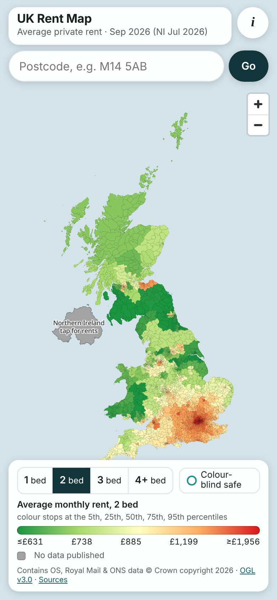
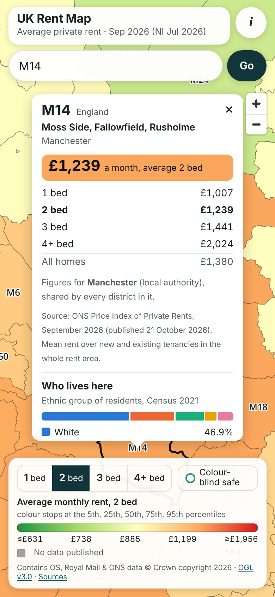

# UK Rent Map

Average private rent for every UK postcode district, as a colour-coded map: green cheapest, red most expensive. Tap a district for its
1/2/3/4+ bedroom rents, or search a postcode. Next.js + TypeScript + MapLibre GL JS, self-hosted PMTiles, installable as an offline PWA.

 

Live: **https://gabpuccini.github.io/ukrentmap/**

```sh
npm install && npm run dev      # http://localhost:3000
```

The repository already contains the built data, so that is all you need. Python is only needed to refresh the data.

## What it shows

- Each postcode district (M14, SW1A, CF10…) is filled on a continuous green→yellow→red ramp by the **average monthly rent** of the area
  it belongs to, for the bedroom count you pick (1, 2, 3 or 4+; 2 by default).
- The colour stops sit at the **5th, 25th, 50th, 75th and 95th percentiles** of the district values for that bedroom count, so the
  ramp follows the real distribution and a handful of very expensive central London districts can't flatten the rest of the country.
  Values beyond the end stops take the end colour. The legend shows the real £ value at each stop.
- **Grey means no published figure.** It is never filled with a guess. That's the City of London and the Isles of Scilly (ONS publishes
  no rent for either) and Northern Ireland's shapes (see below).
- **Colour-blind safe** switches to viridis, which reads correctly for all common colour vision deficiencies. The choice is remembered.
- Labels: district codes fade in from zoom 8. MapLibre's collision detection drops any label that would overlap one already placed,
  and bigger districts are placed first.
- Popup: district code, area name (largest wards and council), the selected rent, a 1/2/3/4+ bed and all-homes breakdown, which rent
  area the figures belong to, any split across areas, and the source and month.
- **Who lives here:** every popup also shows the ethnic groups of the district's own residents, from the census (2021 for England
  and Wales, 2022 for Scotland). It has a bar and five labelled broad groups, with the detailed groups under "More detail". See
  [Census ethnicity](#census-ethnicity).
- **Walking distance:** the walking-person button opens From and To boxes. Type two postcodes, press Go, and you get the shortest
  walking route on streets and footpaths, drawn on the map, with distance and time. It's worked out on the phone. See
  [Walking distance](#walking-distance).
- Search: a full postcode (`SW1A 1AA`), a sector (`M14 5`) or a district (`CF10`). It flies there and opens the popup. Lookup runs
  on the device against the bundled postcode files. There is no geocoding service.
- Data month is in the header: **September 2026** for Great Britain, **July 2026** for Northern Ireland (the latest ONS has).

## Data sources

Everything is free and open. No API keys, no runtime calls to anyone else's servers.

| Data | Source | Edition used | Licence |
| --- | --- | --- | --- |
| Rents (mean monthly, by bedrooms) | [ONS Price Index of Private Rents, UK: monthly price statistics](https://www.ons.gov.uk/economy/inflationandpriceindices/datasets/priceindexofprivaterentsukmonthlypricestatistics) | Published 21 October 2026, data to September 2026 | OGL v3.0 |
| Postcode centroids + council and ward codes | [OS Code-Point Open](https://www.ordnancesurvey.co.uk/products/code-point-open) | November 2026 (Royal Mail update 16 Oct 2026) | OGL v3.0 |
| Scottish Broad Rental Market Areas | [Scottish Government spatial data](https://www.spatialdata.gov.scot/geonetwork/srv/eng/catalog.search#/metadata/ecf60902-9e71-41bc-b822-6a1f37934dc1) | SG_BroadRentalMarketAreas_2009 | OGL v3.0 |
| Coastline (for clipping) | [ONS Countries (December 2025) Boundaries UK BGC](https://geoportal.statistics.gov.uk/) | Dec 2025 | OGL v3.0 |
| Council and ward names | ONS Local Authority Districts (May 2026), Wards (May 2026) | May 2026 | OGL v3.0 |
| Ethnic group, England & Wales | [ONS Census 2021, TS021](https://www.ons.gov.uk/datasets/TS021), output areas, via the [Nomis bulk download](https://www.nomisweb.co.uk/output/census/2021/census2021-ts021.zip) | Census Day 21 March 2021 | OGL v3.0 |
| Ethnic group, Scotland | [Scotland's Census 2022, UV201](https://www.scotlandscensus.gov.uk/documents/2022-output-area-data/), output areas (National Records of Scotland) | Census Day 20 March 2022 | OGL v3.0 |
| Postcode → census output area | ONS Postcode Directory (August 2026), GB rows only | Aug 2026 | OGL v3.0 |
| Walking network | [OpenStreetMap](https://www.openstreetmap.org/copyright), via [Geofabrik](https://download.geofabrik.de/europe/united-kingdom.html) extracts for England, Scotland and Wales | __OSMDATE__ | ODbL 1.0 |
| NI rent areas by postcode district | Northern Ireland Housing Executive, as compiled in [nick-bailey/Postcode-to-BRMA-lookup](https://github.com/nick-bailey/Postcode-to-BRMA-lookup) (OGL) | May 2024 | OGL v3.0 |
| Map fonts | Noto Sans glyphs from [protomaps/basemaps-assets](https://github.com/protomaps/basemaps-assets) | | SIL OFL 1.1 |

Required attribution (shown in the app's key and in its About sheet):

> Contains OS data © Crown copyright and database right 2026. Contains Royal Mail data © Royal Mail copyright and database right 2026.
> Contains National Statistics data © Crown copyright and database right 2026. Source: Office for National Statistics licensed under the
> Open Government Licence v3.0. Contains public sector information from the Scottish Government and National Records of Scotland
> (Scotland's Census 2022) licensed under the Open Government Licence v3.0.

### Why these sources, and what they can't do

- **There is no free official rent data at postcode level.** I looked for a free postcode-sector rent dataset and found none: VOA
  publishes nothing below local authority, and the property-portal data is commercial.
- **ONS/VOA Private Rental Market Statistics (PRMS) is discontinued.** Its last edition covered October 2022 to September 2023. ONS
  replaced it with the **Price Index of Private Rents (PIPR)**, which is monthly, current, covers the whole UK and splits by bedrooms.
  PIPR publishes an **average (mean)**, not a median. It reports local authorities in England and Wales and Broad Rental Market Areas
  (BRMAs, 18 of them) in Scotland and Northern Ireland. It already covers Wales and Scotland, so separate Welsh or Scottish Government
  rent statistics aren't needed (I couldn't find a recent Welsh Government private-rent release anyway).
- **A district inherits its area's rent.** A district takes the rent area (council, or Scottish BRMA) holding most of its live
  postcodes. All districts in an area therefore show the same figure. Where a district straddles a boundary the popup shows the split,
  e.g. TD15: Northumberland 94%, Scottish Borders 6%.
- **District shapes are derived, not official.** Royal Mail's boundaries aren't open data, and ONS publishes no postcode district
  polygons. The shapes are a Voronoi diagram of all 1,748,497 live Code-Point Open postcode centroids: each point owns the land nearer to
  it than to any other postcode. Only the Voronoi edges between postcodes of *different* districts are kept and polygonised, then clipped
  to the ONS coastline. They are close in built-up areas and approximate across empty moorland. 18 tiny districts, mostly PO box and
  large-user codes such as DH98, sit exactly on top of other postcodes and get no shape of their own; they still work in search.
- **Northern Ireland.** Code-Point Open covers Great Britain only. NI postcode locations exist in the ONS Postcode Directory, but under a
  Land & Property Services *End User Licence* that allows "internal business use only… all other uses are prohibited". Publishing them,
  or shapes derived from them, on a public site would break it, so this app doesn't use them at all. Instead, NIHE defines each NI rent
  area as a list of postcode districts, so a BT search shows the right area's ONS rents. NI is drawn as one grey area; tap it for all
  eight areas. ONS's latest NI month is July 2026; ONS estimates the two newer months, and those are not shown.
- PIPR is an average across new **and** existing tenancies, so it runs below advertised asking rents. Scottish figures are mainly for
  advertised new lets (an ONS note).

### Census ethnicity

The popup's "Who lives here" section shows the ethnic groups of the district's usual residents, not the whole council's.

- **Where it comes from.** The census publishes counts for *output areas* of about 125 households: 188,880 in England and Wales,
  46,363 in Scotland. Every live postcode belongs to one output area (ONS Postcode Directory). Each output area's residents are shared
  between postcode districts by how many of its residential postcodes fall in each, then added up per district. That covers 99.99% of
  residents in England and Wales and 99.8% in Scotland.
- **Groups.** There are five broad groups: White; Asian; Black, African or Caribbean; Mixed or multiple; Other, including Arab. Each
  census's own detailed groups are under "More detail". Scotland asks slightly different questions, e.g. it separates White Scottish
  and White Polish.
- **Dates.** England and Wales figures are from March 2021; Scotland's are from March 2022. The popup says which.
- **Gaps.** Districts with fewer than 100 residents (mostly business and PO box districts) show no percentages. Northern Ireland has
  no figures: matching census areas to BT postcode districts would need the NI postcode data, whose licence doesn't allow it.
- I didn't use the [Wikipedia list](https://en.wikipedia.org/wiki/List_of_English_districts_by_ethnicity). It copies the same 2021
  census but only for whole councils, only for England, and for the councils as they were before the 2023 mergers.

These figures change once a decade, so they aren't part of the weekly refresh. `public/data/ethnicity.json` is built once by
`npm run data:ethnicity` (`scripts/build_ethnicity.py`, about 3 minutes, mostly downloading the postcode lookup). Re-run it only to
pick up newly created postcode districts.

### Walking distance

Tap the walking-person button, type a **From** and a **To** postcode (or a district such as `M14`), and press **Go**. The app draws the
shortest walking route with A and B markers and shows, e.g., "2.3 km (1.4 mi) · about 29 min on foot", plus the straight-line
distance for comparison.

- **The network.** It's built from OpenStreetMap: __KM__ km of footpaths, pavements, streets, pedestrian areas, steps, tracks,
  bridleways, cycleways, towpaths and footbridges across Great Britain. Left out: motorways, anything tagged `foot=no` or private,
  driveways and car-park aisles. Separately mapped pavements are also left out, because the street they run beside is already walkable;
  that halves the size in cities without changing the distance meaningfully.
- **On the phone.** The network is split into __TILES__ compressed tiles of about 5 × 5 km (__MB__ MB in total). A route downloads
  only the tiles it passes through, typically a few hundred KB, and the service worker keeps them, so a route you've done works
  offline. The search is A* from the nearest path to each postcode. It is exact for the network: the true shortest path, not an
  estimate.
- **Distances** include the short walk from each postcode's centre to the nearest path. **Times** assume 3 mph (4.8 km/h).
- **Limits.**
  - Routes are offered up to 40 km apart in a straight line.
  - Northern Ireland postcodes can't be used, because their positions aren't open data.
  - Walking ferries aren't included.
  - OpenStreetMap is as good as its mappers: a missing footpath means a longer route.
- **Licence.** OpenStreetMap data is © OpenStreetMap contributors under the Open Database Licence. The app credits it wherever a
  route is shown, and the tiles in `public/data/walk/` are published under the same licence (`public/data/walk/LICENSE`).
- **Rebuilding.** OpenStreetMap changes daily, but walking routes barely move, so this isn't part of the weekly refresh. Run
  `npm run data:walk` (`scripts/build_walk.py`) once in a while. It needs `osmium-tool` (`sudo apt-get install osmium-tool`, or
  `brew install osmium-tool`) and the Python packages in `scripts/requirements.txt`. It downloads about 1.9 GB and takes about
  __MINUTES__ minutes.

## Refreshing the data

ONS publishes PIPR monthly, on a Wednesday in the second half of the month (next: 18 November 2026). OS refreshes Code-Point Open
quarterly.

### Automatically, every week

`.github/workflows/refresh-data.yml` runs on GitHub every **Thursday at 05:17 UTC**:

1. It downloads the latest sources (`scripts/fetch_data.py`).
2. It asks `scripts/data_changed.py` whether anything new was published, comparing the ONS edition and the Code-Point checksum with
   those in `public/data/meta.json`. If nothing is new, it stops there.
3. If there is new data, it rebuilds `public/data/`. `build_data.py` refuses to write anything that fails its safety checks: too few
   postcodes, districts or rent areas, too many districts without a rent, or a rent month older than the one already live.
4. It checks the site still type-checks and builds.
5. It commits the new data to `main` as `github-actions[bot]` and starts **Deploy to GitHub Pages**. Installed copies of the app show
   "A new version is ready".

If any step fails, nothing is committed, the live map keeps its current data, and GitHub emails you about the failed run. To run it by
hand: **Actions → Refresh data → Run workflow**. Tick **force** to rebuild and publish even when nothing new has been released.

Each monthly update adds roughly 10 MB to the repository's history (mostly the tiles, which carry the rents). GitHub switches off
scheduled workflows in public repositories after 60 days without activity. The monthly data commits count as activity, so this keeps
itself going as long as ONS keeps publishing. If it ever stops, the Actions tab offers an **Enable workflow** button.

### By hand

```sh
# one-off setup: Python 3.11+ and tippecanoe
pip install -r scripts/requirements.txt
sudo apt-get install tippecanoe          # macOS: brew install tippecanoe

npm run data      # download everything into data-raw/, then rebuild public/data/ (about 2 minutes)
npm run build     # check it builds
git add public/data && git commit -m "Refresh data to <month>" && git push
```

`npm run data` is two steps you can run separately:

- `npm run data:fetch` (`scripts/fetch_data.py`): finds the newest PIPR spreadsheet on the ONS dataset page, gets the current Code-Point
  Open from the OS Downloads API (checksum verified), and pulls boundaries and names from the ONS Open Geography portal. It writes
  `data-raw/sources.json` recording what was fetched and when.
- `npm run data:build` (`scripts/build_data.py`): builds `districts.pmtiles` (with tippecanoe), `districts.json`, `labels.geojson`,
  `ni.geojson`, `meta.json` (data months, percentile stops, sources) and `pc/*.txt` (postcode search files), all in `public/data/`.

If ONS changes the spreadsheet layout or a geography service is renamed, the scripts stop with an error rather than producing a
partial map. The service names are constants at the top of `fetch_data.py`.

## Deploying (GitHub Pages)

The workflow in `.github/workflows/pages.yml` builds the site and publishes it on every push to `main`.

One-time setup, already done: repository public, **Settings → Pages → Build and deployment → Source: GitHub Actions**.

To deploy, merge the work branch into `main`: open a pull request from `ccr-1b9a9d2f-atr7m1` on GitHub and press **Merge**, or from a terminal:

```sh
git fetch origin
git checkout main
git merge origin/ccr-1b9a9d2f-atr7m1
git push origin main
```

Then watch **Actions → Deploy to GitHub Pages**. When it's green the app is at https://gabpuccini.github.io/ukrentmap/. To redeploy
without a change: **Actions → Deploy to GitHub Pages → Run workflow**. The weekly data refresh starts this deploy itself after
committing new data.

To check a Pages build locally first:

```sh
npm run build:pages && npm run preview      # http://localhost:4173/ukrentmap/
```

### Install it on your phone

Same as Phthalo. Open https://gabpuccini.github.io/ukrentmap/ once and let it finish loading (that fills the offline cache: about
13 MB). Then:

- **iPhone (Safari):** Share → **Add to Home Screen** → Add.
- **Android (Chrome):** ⋮ → **Install app** (or Add to Home screen).

It opens full screen without browser bars and works in flight mode. Postcode files (21 MB in all) are cached per postcode area the
first time you search one, so offline search works for areas you've searched before; district search always works offline. After a
deploy, the app shows **"A new version is ready"** with a Reload button the next time it's opened. GitHub's servers can take up to
10 minutes to hand out a new version. To check by hand, open **(i)** and tap **Check for updates**; that sheet also shows the app
version you're running.

## Privacy

- No accounts, no cookies, no analytics, no third-party requests: tiles, fonts and data all come from the site itself.
- Searches and walking routes never leave the phone: the route is worked out on the device from map tiles fetched from this
  site.
- `noindex` and `robots.txt` keep the site out of search engines.
- The URL is public, like Phthalo's: anyone who has it can open the map, which only shows public government data. If you ever want it
  locked to you alone, it would need a host with a login in front (e.g. Cloudflare Pages + Cloudflare Access, free for personal use).

## Testing

```sh
npm run typecheck
npm i -D playwright && npx playwright install chromium     # once
npm run build:pages && npm test
```

`npm test` (`scripts/smoke.mjs`) drives the built app in Chromium at **390 × 844** (iPhone size) and checks:
- the map renders, the header shows the data month, the legend has £ stops, and there's no horizontal scroll
- search: a postcode opens the right popup with the 1/2/3/4+ breakdown and source; district, NI and unknown postcodes are handled
- census ethnicity: M14's five groups add up to 100%, EH1 shows Scotland's 2022 census, and NI explains why it has none
- walking: Buckingham Palace to Parliament is a sensible distance with the route and A/B markers drawn, a Manchester walk crosses
  tiles, an NI postcode and a too-far walk get clear messages, closing clears the route, and the route works again offline
- the bedroom selector and colour-blind toggle repaint the map and the open popup
- tapping a district opens its popup
- London labels are culled with **zero overlaps**
- the City of London shows "No data" in grey
- the manifest is installable and the service worker takes control
- after a simulated deploy, the app offers "A new version is ready", Reload switches to it, and **Check for updates** finds the
  next one (and says "You have the latest version" when there isn't one)
- the map reloads and searches **offline**
- there are no console errors

It saves screenshots to `screenshots/`.

## How it's built

```
app/                  Next.js App Router shell (static export, one page)
components/
  RentMap.tsx         MapLibre map, style, popups, hover, search wiring
  Controls.tsx        bedroom selector, colour-blind toggle, legend, attribution
  SearchBox.tsx  About.tsx  UpdateToast.tsx  WalkPanel.tsx
lib/
  colors.ts           ramps and the percentile-stop fill expression
  search.ts           on-device postcode parsing and lookup
  popup.ts            popup content (built with DOM calls, never HTML strings)
  walk/tiles.ts       walking-network tile index, download and decoding
  walk/router.ts      snapping to the nearest path and the A* route search
public/
  data/               built data (committed): districts.pmtiles, districts.json, ethnicity.json, labels.geojson, ni.geojson,
                      meta.json, pc/*.txt, walk/ (walking network tiles, ODbL)
  fonts/              glyphs for map labels
  icons/              app icons (scripts/make_icons.py)
  sw.js               service worker (stamped with a content hash at build)
  manifest.webmanifest  robots.txt
scripts/
  fetch_data.py  build_data.py  data_changed.py  build_ethnicity.py  build_walk.py  ni_outcode_brma.csv  requirements.txt
  postbuild.mjs       writes the precache list and version into out/sw.js
  copy-vendor.mjs     copies MapLibre's worker into public/vendor/ (MapLibre 6 needs setWorkerUrl under a bundler)
  serve-out.mjs       local static server with byte ranges, for preview and tests
  smoke.mjs           the phone-width browser test
```

- **Tiles.** `districts.pmtiles` is a single 9 MB file of vector tiles (zoom 4–12) made by tippecanoe with shared-border simplification,
  read through HTTP range requests by the `pmtiles` library. There's no tile server and no basemap: sea, district fills, borders and
  labels are the whole map.
- **Offline.** The service worker caches the app, fonts, tiles and district data on first load. It answers range requests for the
  tiles by slicing its cached copy. Its version is a hash of everything it caches, so any change to code or data makes a new version
  automatically.
- **Base path.** Locally the app is served from `/`; on Pages from `/ukrentmap/` (`NEXT_PUBLIC_BASE_PATH`, set by `build:pages` and
  the workflow).
